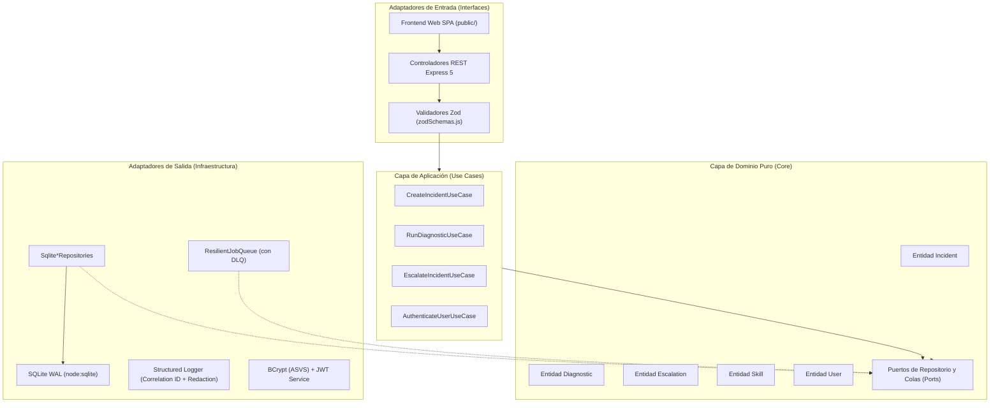
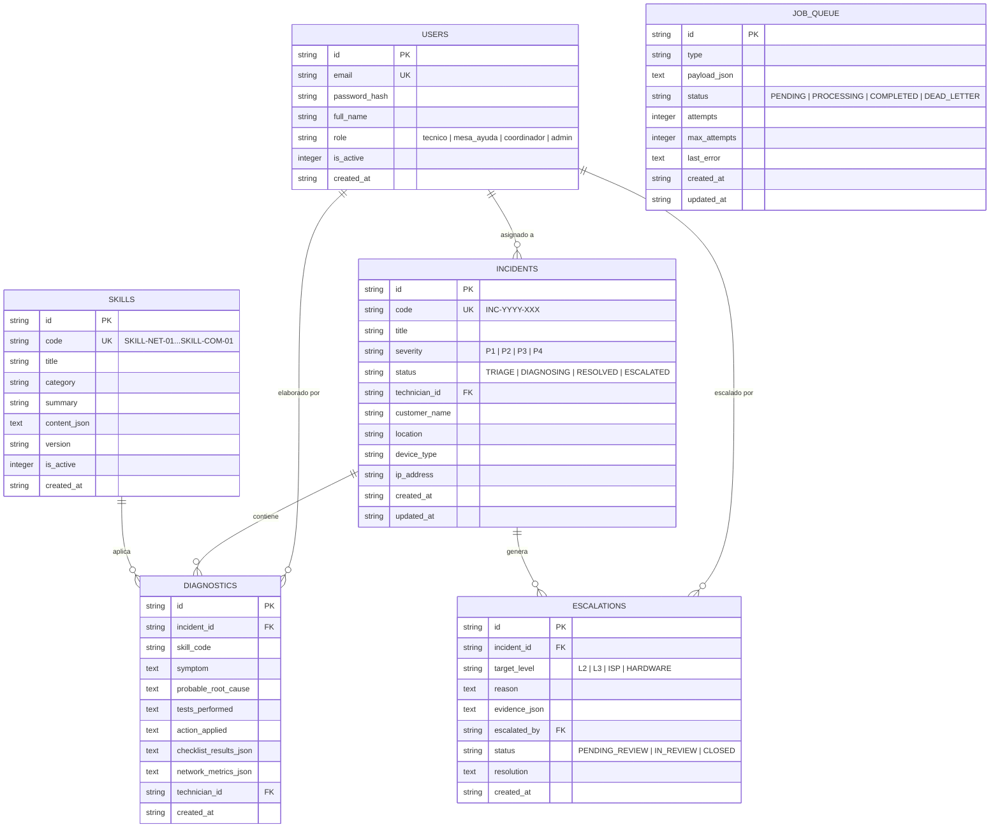

# Manual Técnico de Arquitectura y Desarrollo: FieldOps & Support
## Documentación de Ingeniería de Software, Arquitectura Hexagonal y API REST

---

## 🏛️ 1. Arquitectura Hexagonal (Ports & Adapters)

El sistema está diseñado bajo el patrón de **Arquitectura Hexagonal (Puertos y Adaptadores)**, desacoplando completamente las reglas del negocio de los frameworks, librerías HTTP y motores de base de datos.



### Reglas de Dependencia
- **Capa de Dominio (`src/domain/`):** Contiene la lógica del negocio pura y sus invariantes. **No importa ningún módulo externo, framework HTTP ni librería de base de datos**.
- **Capa de Aplicación (`src/application/`):** Orquesta los flujos de casos de uso invocando los puertos del dominio.
- **Capa de Infraestructura (`src/infrastructure/`):** Implementa los adaptadores técnicos concretos (SQLite, Hashing BCrypt, Generador de Tokens, Cola duradera).
- **Capa de Interfaces (`src/interfaces/`):** Gestiona la entrada HTTP (Express, Middlewares, enrutamiento y schemas Zod).

---

## 🗄️ 2. Modelo de Datos Relacional y Esquema SQLite

El sistema utiliza **SQLite** en modo **WAL (Write-Ahead Logging)** con verificación estricta de claves foráneas activada (`PRAGMA foreign_keys = ON;`).

### Diagrama Entidad-Relación (ERD)



### Optimización y Prevención de Latencia N+1
Para garantizar tiempos de respuesta sub-milisegundo y cumplir con la directiva de optimización de consultas, se implementaron índices compuestos en la migración `002_performance_indexes_and_queues`:
```sql
CREATE INDEX idx_incidents_status_severity ON incidents(status, severity);
CREATE INDEX idx_incidents_technician ON incidents(technician_id);
CREATE INDEX idx_diagnostics_incident_id ON diagnostics(incident_id);
CREATE INDEX idx_escalations_incident_id ON escalations(incident_id);
CREATE INDEX idx_audit_correlation ON audit_logs(correlation_id);
CREATE INDEX idx_job_queue_status ON job_queue(status);
```

---

## 🔄 3. Subsistema de Colas Asíncronas y Dead-Letter Queue (DLQ)

Ubicación: [`src/infrastructure/queue/InMemoryResilientQueue.js`](file:///c:/Users/cabar/Downloads/programa/src/infrastructure/queue/InMemoryResilientQueue.js)

Para procesar tareas en segundo plano (como el archivado de bitácoras, notificaciones a ingenieros L3 o sincronización externa):
1. **Encolado Persistente:** Cada tarea se registra en la tabla `job_queue` con estado `PENDING`.
2. **Límite de Reintentos:** Máximo 3 intentos por defecto.
3. **Aislamiento en Dead Letter Queue (DLQ):** Si una tarea falla 3 veces consecutivas, se actualiza automáticamente a estado `DEAD_LETTER` junto con el mensaje de error `last_error`.
4. **Replay Controlado:** Los administradores o coordinadores pueden solicitar el reintento de tareas desde el endpoint `POST /api/queue/replay/:jobId`.

---

## 🔒 4. Seguridad, Privacidad y Estándares OWASP

- **Autenticación (OWASP ASVS):** Hashing de contraseñas mediante **BCrypt** con factor de costo 10 (`saltRounds = 10`). Sesiones basadas en **JWT (JSON Web Tokens)** firmados con clave secreta y caducidad de 8 horas.
- **Control de Acceso Basado en Roles (RBAC):** Middleware [`requireRoles`](file:///c:/Users/cabar/Downloads/programa/src/interfaces/http/middlewares/authMiddleware.js) que intercepta rutas privilegiadas (ej: solo coordinadores y administradores pueden alterar estados de escalamientos o gestionar la DLQ).
- **Trazabilidad con Correlation ID:** El middleware [`correlationMiddleware.js`](file:///c:/Users/cabar/Downloads/programa/src/interfaces/http/middlewares/correlationMiddleware.js) intercepta la cabecera `x-correlation-id` o genera un UUID único que acompaña cada petición, log y respuesta.
- **Saneamiento de Logs y Privacidad (GDPR):** La utilidad [`logger.js`](file:///c:/Users/cabar/Downloads/programa/src/infrastructure/logging/logger.js) inspecciona de manera recursiva todas las cargas útiles y redacta campos sensibles (`password`, `token`, `authorization`, `secret`).
- **Manejo Seguro de Excepciones:** [`errorHandler.js`](file:///c:/Users/cabar/Downloads/programa/src/interfaces/http/middlewares/errorHandler.js) formatea las respuestas con códigos de error estables (`VALIDATION_ERROR`, `UNAUTHORIZED`, etc.) sin exponer trazas de pila (*stack traces*) al cliente final.

---

## 📡 5. Catálogo de Endpoints de la API REST

Todas las respuestas exitosas devuelven `{ "success": true, "data": ... }`. En caso de error devuelven `{ "success": false, "error": { "code": "...", "message": "...", "correlationId": "..." } }`.

### Autenticación (`/api/auth`)
| Método | Endpoint | Roles Permitidos | Descripción |
| :--- | :--- | :--- | :--- |
| `POST` | `/api/auth/login` | Público | Autentica usuario y devuelve Token JWT. |
| `GET` | `/api/auth/me` | Autenticado | Devuelve los datos del perfil autenticado. |

### Incidentes (`/api/incidents`)
| Método | Endpoint | Roles Permitidos | Descripción |
| :--- | :--- | :--- | :--- |
| `GET` | `/api/incidents` | Autenticado | Lista incidentes con filtros opcionales (`status`, `severity`). |
| `GET` | `/api/incidents/:id` | Autenticado | Obtiene el detalle completo de un incidente. |
| `POST` | `/api/incidents` | Autenticado | Crea un nuevo incidente validado con Zod. |
| `PATCH`| `/api/incidents/:id/assign` | Autenticado | Asigna un técnico y cambia estado a `DIAGNOSING`. |

### Diagnósticos y Bitácoras (`/api/diagnostics`)
| Método | Endpoint | Roles Permitidos | Descripción |
| :--- | :--- | :--- | :--- |
| `POST` | `/api/diagnostics` | Autenticado | Registra diagnóstico (4 campos obligatorios) y genera acta formal. |
| `GET` | `/api/diagnostics` | Autenticado | Lista bitácoras de cierre recientes (límite configurable). |
| `GET` | `/api/diagnostics/incident/:id`| Autenticado | Obtiene bitácoras asociadas a un incidente. |

### Escalamientos (`/api/escalations`)
| Método | Endpoint | Roles Permitidos | Descripción |
| :--- | :--- | :--- | :--- |
| `POST` | `/api/escalations` | Autenticado | Escala un incidente validando al menos 2 evidencias técnicas. |
| `GET` | `/api/escalations` | Autenticado | Lista todos los escalamientos registrados. |
| `PATCH`| `/api/escalations/:id/status` | `coordinador`, `admin` | Actualiza estado y resolución del escalamiento. |

### Skills Modulares y Cola (`/api/skills`, `/api/queue`)
| Método | Endpoint | Roles Permitidos | Descripción |
| :--- | :--- | :--- | :--- |
| `GET` | `/api/skills` | Autenticado | Obtiene el catálogo completo de skills en JSON. |
| `GET` | `/api/skills/:code` | Autenticado | Obtiene comandos y árbol de decisión de una skill. |
| `GET` | `/api/queue/metrics` | `coordinador`, `admin` | Obtiene métricas de la cola y tareas en DLQ. |
| `POST` | `/api/queue/replay/:jobId` | `coordinador`, `admin` | Reencola una tarea fallida desde la DLQ. |

---

## 🧪 6. Suite de Pruebas Automatizadas

El proyecto utiliza el test runner nativo de Node.js (`node:test` y `node:assert`):

```bash
# Ejecutar todas las pruebas
npm test

# Ejecutar pruebas unitarias de dominio
npm run test:unit

# Ejecutar pruebas de integración
npm run test:integration
```

### Cobertura de Pruebas Implementada
1. [`domain_incident.test.js`](file:///c:/Users/cabar/Downloads/programa/tests/unit/domain_incident.test.js): Validación de títulos, severidades P1-P4, cálculo de SLA y máquinas de estado sin persistencia.
2. [`domain_diagnostic.test.js`](file:///c:/Users/cabar/Downloads/programa/tests/unit/domain_diagnostic.test.js): Verificación estricta de las 4 secciones normativas de bitácora y validación de evidencias mínimas de escalamiento.
3. [`resilient_queue.test.js`](file:///c:/Users/cabar/Downloads/programa/tests/unit/resilient_queue.test.js): Prueba de reintentos, aislamiento de fallos en Dead Letter Queue y replay controlado.
4. [`api_flow.test.js`](file:///c:/Users/cabar/Downloads/programa/tests/integration/api_flow.test.js): Prueba de integración end-to-end simulando una jornada técnica completa.
