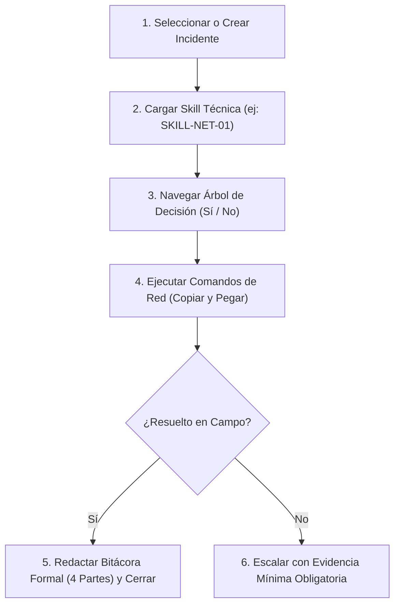

# Manual de Usuario: FieldOps & Support
## Plataforma de Estandarización de Triaje, Diagnóstico de Red y Bitácoras Operativas

---

## 📖 1. Introducción y Propósito

El sistema **FieldOps & Support** es una plataforma operativa diseñada para estandarizar el triaje técnico de fallas de red y puestos de trabajo, automatizar la redacción de bitácoras de cierre y formalizar el escalamiento de incidentes hacia niveles superiores (L2, L3 NOC o Proveedores ISP).

### Objetivos Clave
- Reducir el tiempo medio de diagnóstico en sitio (**MTTD**) mediante árboles de decisión guiados.
- Eliminar la ambigüedad en los reportes mediante una estructura obligatoria de 4 secciones normativas:
  $$\text{1. Síntoma} \longrightarrow \text{2. Pruebas realizadas} \longrightarrow \text{3. Causa raíz probable} \longrightarrow \text{4. Acción aplicada}$$
- Evitar el rebote de incidentes hacia ingeniería asegurando el cumplimiento de una matriz de evidencia mínima obligatoria.

---

## 👥 2. Perfiles y Roles de Usuario (RBAC)

La plataforma cuenta con 4 roles operativos preconfigurados:

| Rol | Usuario Demostrativo | Perfil y Responsabilidades |
| :--- | :--- | :--- |
| **Técnico en Campo** | `tecnico1@fieldops.local` | Ejecuta el triaje en sitio, aplica skills de red, ejecuta checklists y genera bitácoras de cierre. |
| **Mesa de Ayuda (L1/L2)**| `mesa1@fieldops.local` | Registra nuevos incidentes, clasifica la severidad inicial (P1–P4) y asigna técnicos. |
| **Coordinador Operativo**| `coordinador@fieldops.local` | Supervisa incidentes activos, revisa escalamientos hacia proveedores y gestiona colas. |
| **Administrador General**| `admin@fieldops.local` | Acceso global a configuración, auditoría, catálogos y reintentos (replay) en DLQ. |

> [!TIP]
> **Cambio Rápido de Perfil:** En la esquina superior derecha de la cabecera web encontrarás el botón **"Cambiar Rol"**. Con un solo clic puedes alternar entre Técnico, Mesa de Ayuda, Coordinador y Administrador para probar los distintos flujos operativos.

---

## 🖥️ 3. Navegación General de la Interfaz

La aplicación cuenta con una navegación por pestañas accesibles en la parte superior:

```
[ ⚡ Triaje en Vivo ]  [ 📚 Banco de Skills ]  [ 📋 Bitácoras de Cierre ]  [ 🚨 Escalamiento (P1-P4) ]  [ ⚙️ Monitor de Cola ]  [ 💬 Guía de Comunicación ]
```

1. **⚡ Triaje y Diagnóstico en Vivo:** Vista operativa principal para atender incidentes, seguir árboles de decisión y redactar actas.
2. **📚 Banco Modular de Skills:** Catálogo interactivo de conocimientos técnicos autocontenidos y comandos verificables.
3. **📋 Bitácoras y Actas de Cierre:** Historial de informes de servicio generados con visor en texto plano y exportación JSON.
4. **🚨 Escalamiento Técnico (P1–P4):** Consola de escalamiento anti-rebote con comprobación de evidencias técnicas.
5. **⚙️ Monitor de Cola y DLQ:** Supervisión de procesos asíncronos y recuperación de tareas fallidas.
6. **💬 Guía de Comunicación:** Frases modelo de empatía, traductor de jerga técnica y protocolo de cierre con el usuario.

---

## ⚡ 4. Guía Operativa: Paso a Paso del Triaje en Vivo



### Paso 1: Seleccionar o Registrar un Incidente
- En la tabla de la izquierda **"Incidentes en Atención"**, haz clic en el botón azul **"Triaje"** del incidente que vas a atender.
- Si requieres crear uno nuevo, presiona el botón **"+ Nuevo Incidente"**:
  - Ingresa el **Título del Incidente** (mínimo 5 caracteres).
  - Selecciona la **Severidad** (P1 a P4 según el impacto operacional).
  - Especifica el **Tipo de Dispositivo** (Router, Switch, AP Wi-Fi, PC, Servidor).
  - Digita el nombre del **Cliente / Sede** y la **Dirección IP** de referencia.
  - Presiona **"Registrar Incidente"**.

### Paso 2: Cargar la Skill Técnica Apropiada
En el panel derecho **"Asistente de Triaje Paso a Paso"**, selecciona la skill adecuada en la lista desplegable:
- `SKILL-NET-01`: Conectividad Física e IP Local (L1/L2, APIPA `169.254.x.x`, Gateway).
- `SKILL-NET-02`: Latencia, Jitter y Pérdida de Paquetes (`ping` sostenido, saturación, `tracert`).
- `SKILL-NET-03`: Resolución DNS (Ping a IP responde pero falla a dominio, `ipconfig /flushdns`, `nslookup`).
- `SKILL-NET-04`: Configuración Local, MTU y Firewall (`ping -f -l 1472`, proxies WinHTTP).

### Paso 3: Interactuar con el Árbol de Decisión
- El asistente mostrará una pregunta técnica guiada con dos botones: **"✅ SÍ"** y **"❌ NO"**.
- Al presionar **"SÍ"**, el asistente valida la prueba exitosa y avanza automáticamente al siguiente paso de diagnóstico.
- Al presionar **"NO"**, el asistente aísla la causa raíz técnica más probable y sugiere la acción correctiva inmediata, **autocompletando automáticamente la causa raíz en el formulario de la bitácora**.

### Paso 4: Ejecutar Comandos de Referencia Verificables
Debajo del árbol de decisión encontrarás bloques de comandos de terminal listos para ejecutar.
- Haz clic en el botón **"Copiar"** para llevar el comando a tu portapapeles.
- Abre tu terminal en el equipo del usuario (PowerShell o CMD) y pégalo.
- Compara la salida real con la **"Salida esperada"** indicada en la tarjeta.

---

## 📝 5. Redacción y Cierre de la Bitácora de Servicio

Cuando la falla ha sido diagnosticada o resuelta, debes completar el formulario inferior de **Bitácora Técnica**:

1. **1. Síntoma Reportado y Observado:** Detalla el problema desde la perspectiva del usuario y del equipo (ej: *Luz de enlace apagada en router y tarjeta en estado sin red*).
2. **2. Pruebas y Comandos Realizados:** Indica las mediciones cuantitativas (ej: *ipconfig reportó 169.254.12.80; ping al gateway 192.168.1.1 con 100% loss*).
3. **3. Causa Raíz Probable:** Explicación técnica precisa (ej: *Patch cord UTP categoría 6 defectuoso en los pines 1 y 2*).
4. **4. Acción Aplicada y Resultado:** Trabajo correctivo realizado (ej: *Sustitución de cable por nuevo certificado de 2m. Se obtuvo IP 192.168.1.45 por DHCP. Ping a gateway 1ms sin pérdida*).
5. **Casilla de Cierre:** Deja marcada la opción *"Marcar incidente como RESUELTO tras guardar esta bitácora"*.
6. Haz clic en **"💾 Guardar y Generar Acta Formal"**.

### Exportación y Copiado del Acta
Se abrirá automáticamente el visor modal del acta:
- Presiona **"Texto Plano"** y haz clic en **"📋 Copiar al Portapapeles"** para pegar el acta directamente en tu sistema de tickets corporativo (Jira, ServiceNow, Remedy, etc.).
- Presiona **"⬇️ Descargar JSON"** para guardar una copia de auditoría digital en tu dispositivo.

---

## 🚨 6. Procedimiento de Escalamiento Técnico (Anti-Rebote)

Si tras aplicar las pruebas de la skill la falla corresponde a un corte de fibra del ISP, falla de hardware o configuración avanzada en el Core de red:

1. Presiona el botón rojo **"🚨 Escalar a Nivel Superior (P1–P4)"**.
2. Selecciona el **Nivel Destino**:
   - `L2 - Especialista de Soporte Avanzado` (Configuración de VLANs, enrutamiento interno).
   - `L3 - Ingeniería de Red / NOC` (BGP, enlaces troncales, caídas masivas).
   - `Proveedor ISP / Carrier` (Última milla, atenuación de fibra, corte de enlace público).
   - `Garantía / Reemplazo de Hardware` (Daño físico irreparable de puertos o fuentes).
3. Redacta la **Justificación Técnica** (mínimo 10 caracteres).
4. **⚠️ Matriz de Evidencias Mínimas (Obligatorio completar al menos 2):**
   - **Evidencia 1 (Ping Cuantitativo):** Resultados de al menos 20 pings con porcentaje de pérdida y latencia.
   - **Evidencia 2 (Configuración IP):** Salida completa de `ipconfig /all`.
   - **Evidencia 3 (Tracert):** Trazado de ruta indicando el salto exacto donde se genera el corte.
5. Presiona **"Confirmar y Escalar Incidente"**.

> [!IMPORTANT]
> El sistema rechazará automáticamente cualquier escalamiento que no adjunte al menos 2 evidencias técnicas cuantitativas. Esto previene el rebote de incidentes por falta de datos.

---

## 💬 7. Buenas Prácticas de Comunicación con el Usuario Final

En la pestaña **"Guía de Comunicación"** tienes a tu disposición:
- **Traductor de Jerga Técnica:** Frases claras para explicar al usuario conceptos como "IP APIPA", "Jitter / Latencia" o "Falla DNS" sin usar tecnicismos confusos.
- **Protocolo de Validación Compartida:** Antes de cerrar la visita técnica, pídele al usuario que realice su labor habitual en el sistema para confirmar conjuntamente el éxito del servicio:
  > *"Hemos restablecido la conexión y las pruebas de red muestran tiempos de respuesta óptimos. Por favor, intente ingresar a su sistema y realizar su tarea habitual para verificar juntos que todo opere con normalidad."*
- **Frases Prohibidas:** Nunca uses frases como *"El problema fue culpa de ustedes"*, *"Abra otro ticket"* o *"La red se cayó y no hay nada que hacer"*.
